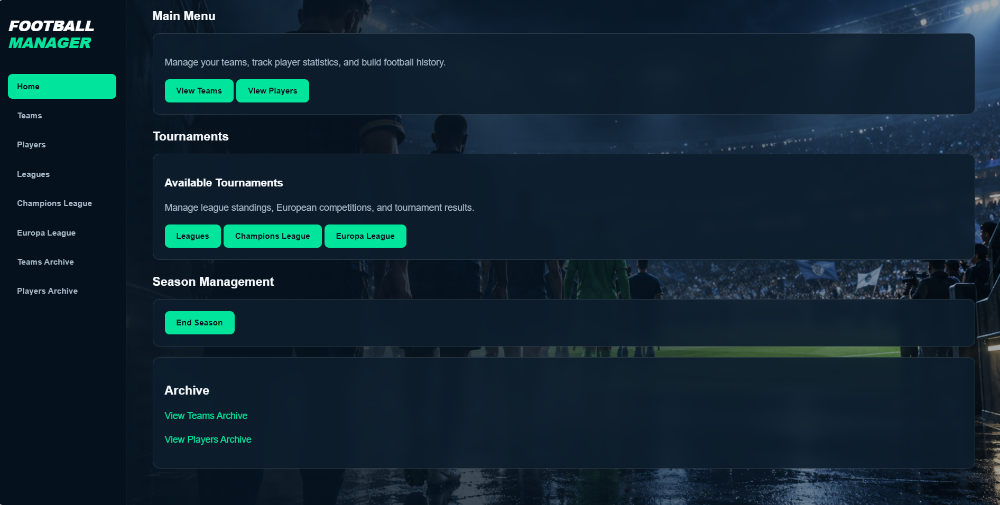
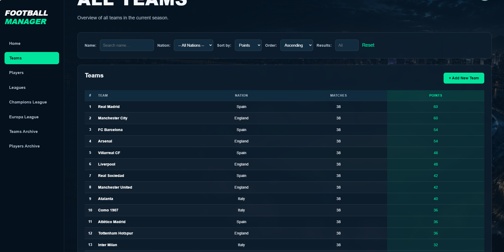
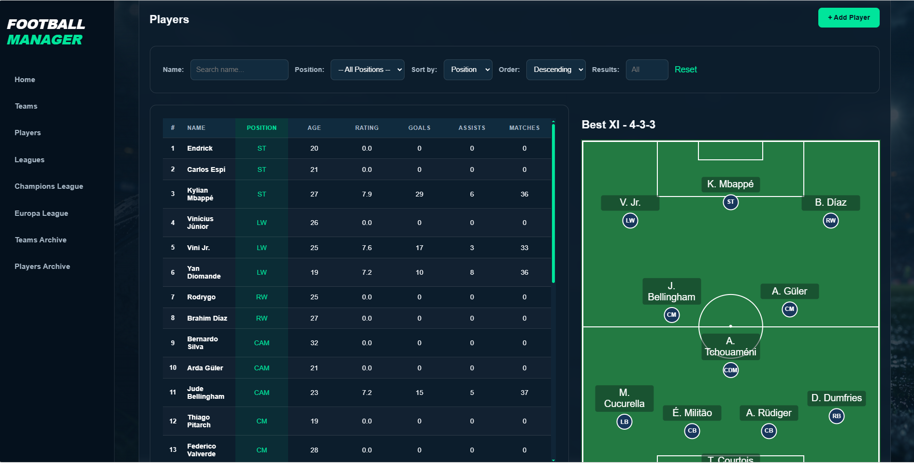
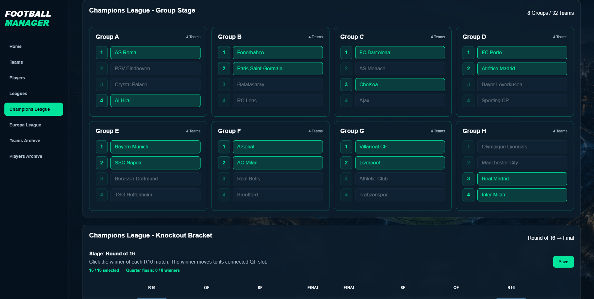
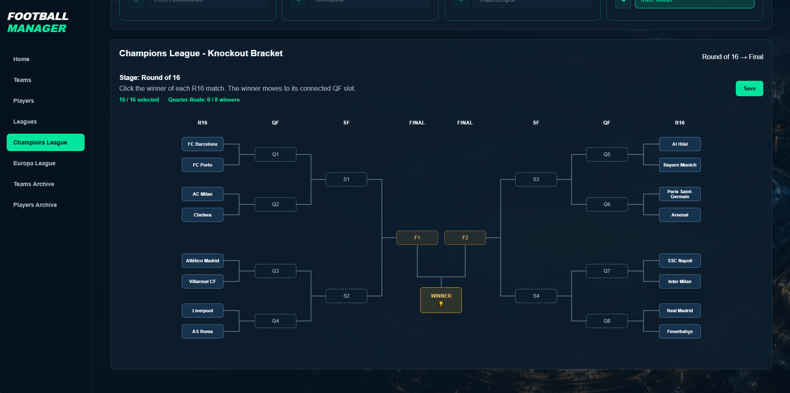
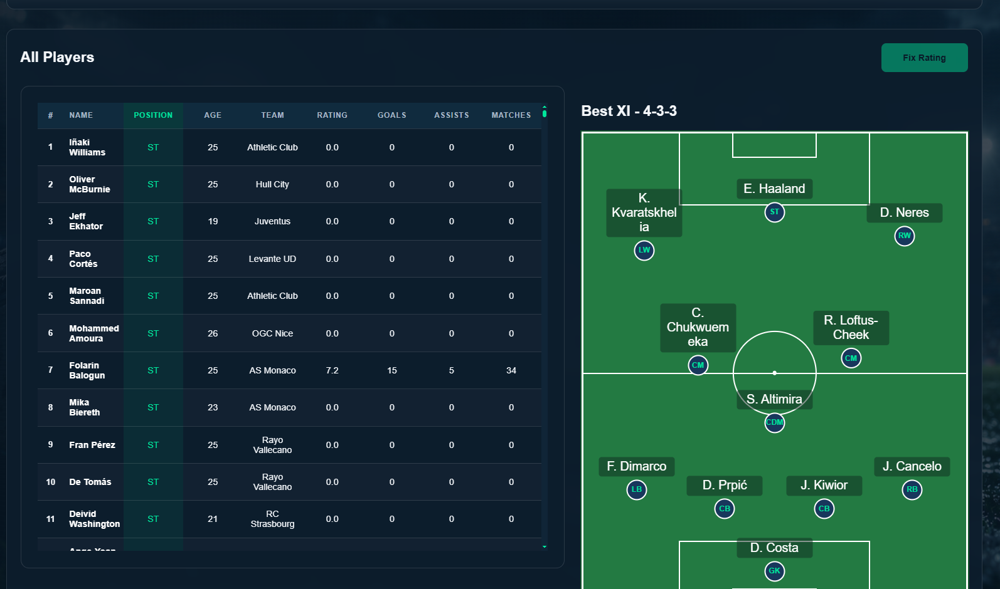
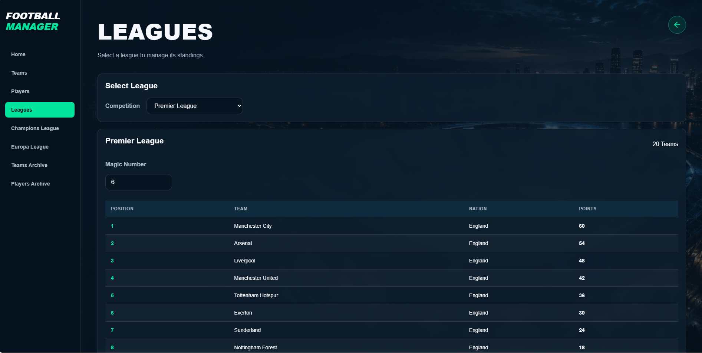

# Football Team Manager

**A season-based football management application built with PHP, MySQL, HTML, CSS, and JavaScript.**

Football Team Manager is a web application for managing football clubs and players, organizing domestic and European competitions, tracking player and team statistics, and preserving a multi-season history. It brings together CRUD operations, league standings, knockout brackets, individual awards, and season archiving in one application.

The project was developed as a practical PHP/MySQL application, with an emphasis on database-driven workflows, reusable PHP helpers, server-side validation, and transactional updates.

## Features

### Teams and players

- Create, view, update, and delete football teams and players.
- Assign players to teams and manage positions such as GK, CB, RB, LB, CDM, CM, CAM, RW, LW, and ST.
- Track team matches and points, and player matches, goals, assists, and ratings.
- Filter and sort player and team data.
- View player and team details and a position-based **4-3-3 formation**.
- Navigate from formation positions to player details.

### Domestic leagues

Organize **nine domestic league competitions**:

- England
- Spain
- Italy
- Germany
- France
- Portugal
- Netherlands
- Turkey
- Rest of the World

The league workflow supports ordering participating teams, calculating league points according to the configured scoring logic, saving an unfinished competition, and finalizing its results. Finalization updates the participating teams' season statistics and records the league winner and individual awards.

### UEFA-style knockout competitions

**Champions League**

- Select 32 participating teams across four pots.
- Organize eight groups.
- Select Round of 16 qualifiers, subject to group participation rules.
- Progress through the Round of 16, quarter-finals, semi-finals, and final in a mirrored tournament bracket.
- Save the current bracket and selected qualifiers between stages.
- Finalize the tournament and record the champion.

**Europa League**

- Select 16 participating teams.
- Manage a knockout bracket from the Round of 16 through the final.
- Save intermediate progress and record the eventual winner.

### Individual awards

Each completed league, Champions League, or Europa League competition can record:

- **Best Player**
- **Top Scorer**
- **Top Assister**

Award candidates are restricted to players belonging to the teams participating in that competition. The selected winners are stored by player ID in the `tournaments` table, allowing historical counts to be displayed on archived player profiles.

### Player ratings

- Track season and historical player ratings.
- Apply a season rating adjustment based on team points and player participation.
- Penalize participation below 40 matches by **0.1 rating points per missing match**, as part of the rating-adjustment workflow.
- Prevent the season's rating-fix operation from being applied repeatedly through the competition-status system.

### Season management and historical archive

The **End Season** operation:

1. Calculates the season's Best XI and individual season awards.
2. Archives participating players' season statistics.
3. Updates accumulated team statistics in the archive.
4. Calculates historical player ratings using an average weighted by archived seasons.
5. Applies the configured rating decay to qualifying players without a current-season rating.
6. Resets current-season player and team statistics for the next season.

Database changes are grouped into a **MySQL transaction** so that an error can trigger a rollback instead of leaving partially updated season records.

The historical archive includes:

- Accumulated team statistics and number of archived seasons.
- Accumulated player statistics, historical ratings, and last recorded team.
- A historical player profile displaying earned tournament awards.
- An archived player formation.

A dedicated `seasons` table stores the **Best XI (4-3-3)** and season-level Best Player, Top Scorer, and Top Assister by player ID.

## Technology stack

| Layer | Technologies |
| --- | --- |
| Backend | PHP 8.2, procedural PHP with reusable helper functions |
| Database | MySQL, MySQLi, prepared statements |
| Frontend | HTML5, CSS3, vanilla JavaScript |
| Local development | Apache and MySQL via XAMPP |
| Tournament progress | JSON files stored on the server |

The project does not require a PHP application framework for its core functionality.

## How it works

A tournament uses **two separate persistence stages**:

```text
User selects a competition
             |
             v
PHP loads clubs, season and saved competition state
             |
             v
User changes standings / qualification / bracket
             |
             v
SAVE  ------------------> Server-side JSON progress
             |                    |
             |<---- Resume -------|
             v
Competition completed
             |
             v
FINISH -> PHP validates submitted results and awards
             |
             v
MySQL transaction updates teams and tournament records
             |
             v
Committed competition results and historical award records
```

**Save** preserves progress without granting final competition points. **Finish** validates the completed competition and applies its final database updates. This separation reduces the risk of applying results multiple times while a competition is still being edited.

## Project structure

The following tree summarizes the main application areas. Exact supplementary asset filenames may differ between revisions.

```text
teammanager/
├── index.php                    # Main dashboard and navigation
├── teams/                       # Team CRUD and details
├── players/                     # Player CRUD, details and rating workflow
├── tournaments/                 # League, Champions and Europa workflows
│   ├── leagues.php
│   ├── champions.php
│   ├── europa.php
│   ├── finalize_league.php
│   ├── finalize_champions.php
│   ├── finalize_europa.php
│   └── partials/
│       ├── champions_bracket.php
│       └── europa_bracket.php
├── season/
│   ├── end_season.php           # Season rollover and archive updates
│   └── simulate.php             # Test simulation utility
├── archive/                      # Historical teams and players
│   ├── teams_archive.php
│   ├── players_archive.php
│   └── player_archive_details.php
├── helpers/                      # Database and reusable PHP logic
│   ├── db.php
│   ├── formation.php
│   ├── table.php
│   ├── query_helpers.php
│   ├── tournament_storage.php
│   ├── tournament_awards.php
│   ├── tournament_awards_ui.php
│   └── season_awards.php
├── assets/
│   ├── css/
│   └── js/
└── storage/
    ├── .htaccess                # Restricts direct HTTP access (Apache)
    └── tournaments/             # Saved JSON competition progress
```

### Main data model

| Table | Purpose |
| --- | --- |
| `teams` | Current clubs, countries, matches, and points |
| `players` | Current players, club assignments, positions, and season statistics |
| `teams_archive` | Accumulated historical team statistics |
| `players_archive` | Accumulated historical player statistics and ratings |
| `tournaments` | Season/competition status, winner, and competition-level awards |
| `seasons` | Season Best XI and season-wide individual awards |

Player identifiers are retained when referring to awards in current and historical records. Competition results are differentiated by season and competition key.

## Running locally

### Prerequisites

- PHP **8.2** or a compatible PHP version, with the `mysqli` extension enabled.
- Apache web server.
- MySQL server.
- XAMPP is recommended for a straightforward Windows setup.

### Setup

1. Clone the repository into the XAMPP document root (`htdocs`):

   ```bash
   git clone https://github.com/YOUR_USERNAME/YOUR_REPOSITORY.git teammanager
   ```

2. Start **Apache** and **MySQL** from the XAMPP Control Panel.
3. In phpMyAdmin, create a database named `teammanager`.
4. Import the project's **complete database SQL export**, including the current tables and relevant schema migrations, into `teammanager`.
5. Check the local database connection configuration in `helpers/db.php`.
6. Ensure the application can write tournament progress files in `storage/tournaments/`.
7. Open:

   ```text
   http://localhost/teammanager/
   ```

> **Database setup note:** A complete, verified SQL schema export has not been established from the project files available for this README. The application cannot be installed into an empty database until that schema is included. Add a sanitized database export to the repository (for example, `database/schema.sql`) and update step 4 to reference its actual filename.

### Database connection

The inspected local project snapshot uses MySQLi with the following development connection:

```php
$con = new mysqli('localhost', 'root', '', 'teammanager');
```

For deployment, replace local credentials with environment-specific settings. Do **not** publish real database passwords or production connection secrets.

## Data integrity and safeguards

The application's PHP workflows make use of:

- **Prepared SQL statements** for parameterized lookups and updates.
- **Server-side validation** of tournament selections and award eligibility.
- **Transactions** for finalized tournament results and season rollover.
- **Session-based CSRF tokens** in tournament submission workflows.
- **Escaped HTML output** with `htmlspecialchars()` in relevant views.
- Apache `.htaccess` rules restricting direct browser access to saved tournament JSON files.

These controls are part of the implemented workflows; this README is **not** a claim that the project has undergone a comprehensive security audit. Authentication, authorization, deployment configuration, and input handling should be reviewed before exposing the application on a public server.

## Development and testing

The application was developed incrementally, testing each feature before moving on to the next. Important workflows to verify locally include:

- Team and player CRUD operations.
- League participant selection, ordering, saving, and finalization.
- Champions League group qualification and knockout progression.
- Europa League knockout progression.
- Restriction of award candidates to participating teams.
- Award persistence and display in player archive details.
- One-time rating adjustment and participation penalties.
- Successful season archive/rollover and rollback on database errors.

The `season/simulate.php` route is intended for development/testing and should be restricted or disabled in a public deployment if it is not needed.

## Notes on the current scope

- The project manages results and aggregates rather than storing a complete event-by-event match log.
- Competition progress is stored in server-side JSON, while finalized records and cumulative statistics live in MySQL.
- The archive records aggregate historical totals, not a complete per-match or per-season statistical breakdown for every player.
- The current-season calculation in the existing rollover workflow derives its value from archived team `seasons` counts. If clubs have different participation histories, a dedicated global season counter would be more robust.

## Screenshots

The following screenshots highlight the main workflows of the application, from day-to-day team and player management to competition handling and season archives.

### 1. Dashboard and season controls

The main menu gives quick access to teams, players, leagues, European competitions, season rollover, and archive views.



### 2. Team management

A searchable and sortable teams overview lists clubs, nations, matches, and points, and supports adding new teams.



### 3. Player management and Best XI

The players section combines player statistics with a position-based **Best XI (4-3-3)** visualisation.



### 4. Domestic league standings

League management displays standings for individual domestic competitions and supports season-specific competition tracking.



### 5. Champions League group stage

The UEFA-style Champions League workflow includes group assignment and qualification tracking before the knockout rounds.



### 6. Historical player archive

Archived player profiles preserve long-term statistics, awards, and season history beyond the current campaign.



### 7. Champions League knockout bracket

The knockout stage uses a mirrored bracket layout from the Round of 16 to the final, with stage progression and save support.



## License

No license has been specified for this repository. Add a `LICENSE` file if you want to explicitly permit others to use, modify, or redistribute the code.
